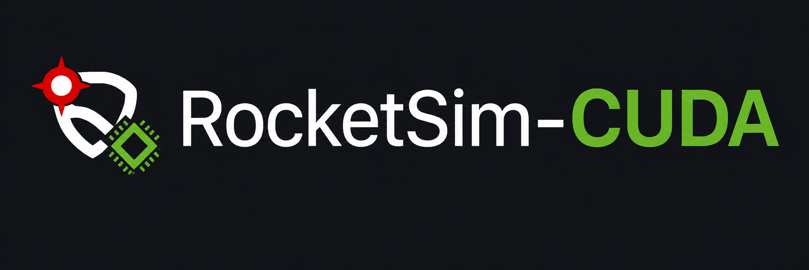

<div align="center">

# RocketSim-CUDA

**Massively Parallel, GPU-Native Rocket League Physics Engine**

[](https://developer.nvidia.com/cuda-toolkit)
[](https://isocpp.org/)
[](https://pytorch.org/)
[](LICENSE)
[]()

<br>



<p align="center">
  A ground-up C++/CUDA reimplementation of <a href="https://github.com/ZealanL/RocketSim">ZealanL's RocketSim</a> designed to simulate tens of thousands of Rocket League matches concurrently on GPU with <b>zero-copy PyTorch/DLPack tensor integration</b>.
</p>

</div>

---

## Why RocketSim-CUDA?

While the original [RocketSim](https://github.com/ZealanL/RocketSim) is exceptionally optimized for multi-core CPUs, scaling reinforcement learning workloads across dozens of CPU threads encounters severe bottlenecks:

1. **CPU Saturation:** Simulating dozens of CPU environments pins host processors at 100%, competing with data loaders and policy neural network training.
2. **PCIe Latency Wall:** Continuously copying rollout observations, rewards, and actions between CPU RAM and GPU VRAM bottlenecks throughput.
3. **GPU Underutilization:** High-end GPUs sit mostly idle waiting for CPU physics rollouts to complete.

**RocketSim-CUDA eliminates the CPU from the simulation loop.** The engine runs physics, suspension raycasts, analytical arena collisions, car dynamics, car-ball contact resolution, car-car bumps, demolitions, and boost pads natively in GPU VRAM with zero host copies (`cudaMemcpy = 0`).

---

## Key Features

* **Massive Concurrency:** Simulate **16,384 to 65,536+ environments simultaneously** on a single consumer or workstation GPU.
* **Complete Soccar Physics:** Full recreation of car dynamics, 4-wheel suspension raycaster, aerial controls, jumps, dodges/flips, boost mechanics, arena collisions, ball aerodynamics, car-ball impacts, car-car bumps, and supersonic demolitions.
* **Canonical Hitboxes:** Full support for Octane, Dominus, Plank/Batmobile, Breakout, Hybrid, and Merc hitbox presets.
* **Closed-Form Arena SDF:** High-performance analytical Signed Distance Fields for walls, corner chamfers, curved ramps, and goal cavities, avoiding slow mesh raycasting.
* **Zero-Copy PyTorch / DLPack Pipeline:** Actions, observations, rewards, and terminations live entirely in VRAM. Step tens of thousands of environments without PCIe transfers.
* **Deterministic Precision:** Consistent single-precision floating-point arithmetic matching the original RocketSim behavior.

---

## Performance Benchmarks

Below is a direct comparison between the original **RocketSim (CPU)** and **RocketSim-CUDA (GPU)** under identical match conditions (Default Soccar arena, 2v2 match setup, and random inputs changed every 2–60 ticks per car):

```text
OS: Windows 11 Pro 64-bit (Process Priority = Normal)
CPU: AMD Ryzen 5 5500 @ 3.60GHz (6 Cores / 12 Threads)
GPU: NVIDIA GeForce RTX 5060 (8 GB VRAM)
Ram Speed: 3800MHz (16GB Dual-Channel DDR4)
Compiler: MSVC 19.41 / NVCC 13.4
=================================
Arena: Default (Soccar)
Cars: 2 on each team (2v2)
Inputs: Randomly pre-generated, changed every 2-60 ticks for each car
=================================
Single-thread performance (1M ticks simulated):
RocketSim CPU (AMD Ryzen 5 5500) = 70,728 TPS
(Intel i5-11400 Reference v2.1.0 = 114,481 TPS)

Multi-thread performance (12 threads on 12 logical cores) (12M ticks simulated):
RocketSim CPU (AMD Ryzen 5 5500) = 438,743 TPS
(Intel i5-11400 Reference v2.1.0 = 551,328 TPS)

RocketSim-CUDA (NVIDIA GeForce RTX 5060) (32,768 envs, 131,072 cars):
Batch Step Latency  = 0.9977 ms
Physical Throughput = 32,843,560 SPS (Arena TPS)
Agent Throughput    = 131,374,239 Car-SPS (Car-Ticks/s)
```

### Comparative Summary

| Implementation | Hardware | Concurrency | Step Latency | Physical TPS (Arenas/s) | Agent TPS (Car-Ticks/s) | Speedup vs CPU |
| :--- | :--- | :---: | :---: | :---: | :---: | :---: |
| **RocketSim CPU (Single-Thread)** | AMD Ryzen 5 5500 | 1 Thread | $14.14\,\mu\text{s}$ | 70,728 TPS | 282,912 Car-TPS | Baseline (1.0x) |
| **RocketSim CPU (Multi-Thread)** | AMD Ryzen 5 5500 | 12 Threads | $2.28\,\mu\text{s}$ (eff.) | 438,743 TPS | 1,754,972 Car-TPS | 6.2x |
| **RocketSim-CUDA (GPU)** | NVIDIA RTX 5060 | 32,768 Arenas | **0.9977 ms** | **32,843,560 SPS** | **131,374,239 Car-SPS** | **464x (75x vs 12T)** |

### Master Throughput Scaling Matrix

Simulating complete physics (Car dynamics, suspension, arena collisions, car-ball contact, car-car bumps/demos, boost pads, and goal detection) at 120 Hz on an **NVIDIA GeForce RTX 5060**:

| Match Setup | Concurrent Arenas | Total Active Cars | Batch Latency (ms) | Physical SPS (120 Hz) | Agent SPS (Car-Ticks/s) |
| :---: | :---: | :---: | :---: | :---: | :---: |
| **1v0** | 16,384 | 16,384 | 0.0628 ms | **260,889,499 SPS** | 260,889,499 Car-SPS |
| | 32,768 | 32,768 | **0.0873 ms** | **375,262,947 SPS** | 375,262,947 Car-SPS |
| **1v1** | 16,384 | 32,768 | 0.0820 ms | 199,804,878 SPS | 399,609,756 Car-SPS |
| | 32,768 | 65,536 | 0.1260 ms | 260,063,492 SPS | **520,126,984 Car-SPS** |
| **2v2** | 16,384 | 65,536 | 0.2070 ms | 79,131,206 SPS | 316,524,825 Car-SPS |
| | 32,768 | 131,072 | 0.9977 ms | 32,843,560 SPS | **131,374,239 Car-SPS** |
| **3v3** | 16,384 | 98,304 | 0.2980 ms | 54,979,865 SPS | 329,879,194 Car-SPS |
| | 32,768 | 196,608 | 0.5620 ms | 58,306,049 SPS | **349,836,298 Car-SPS** |

---

## Architecture Overview

```
┌──────────────────────────────────────────────────────────────┐
│                      GPU VRAM (cuda:0)                       │
│                                                              │
│   ┌─────────────────────┐          ┌─────────────────────┐   │
│   │   RocketSim-CUDA    │ ◄──────► │ PyTorch / DLPack    │   │
│   │   SimContext SoA    │  Zero    │ Rollout Buffers     │   │
│   └──────────┬──────────┘  Copy    └──────────┬──────────┘   │
│              │                                │              │
│   ┌──────────▼──────────┐          ┌──────────▼──────────┐   │
│   │ CUDA Physics Kernel │          │  PPO Neural Network │   │
│   │ (SDF, Car, Ball)    │          │ (Forward/Backward)  │   │
│   └─────────────────────┘          └─────────────────────┘   │
└──────────────────────────────────────────────────────────────┘
▲
No Host PCIe Traffic (0 bytes transferred during step loop)
▼
┌──────────────────────────────────────────────────────────────┐
│                      Host CPU (1 Thread)                     │
│               Dispatches async CUDA streams only             │
└──────────────────────────────────────────────────────────────┘
```

---

## Quick Start (Python & Zero-Copy RL)

```python
import torch
from src.bindings.gym_env import RocketSimBatchedEnv

# 1. Initialize 16,384 environments concurrently on GPU (2v2 mode: 4 cars per arena)
env = RocketSimBatchedEnv(
    num_envs=16384,
    cars_per_env=4,
    tick_skip=8  # 8 physical ticks (120Hz) per environment step
)

# 2. Reset environments to kickoff poses
obs = env.reset()

# 3. Pre-allocate actions tensor directly in GPU VRAM (shape: [total_cars, 8])
# Columns: [throttle, steer, pitch, yaw, roll, jump, boost, handbrake]
actions = torch.zeros((env.total_cars, 8), device="cuda", dtype=torch.float32)
actions[:, 0] = 1.0  # Full throttle
actions[:, 6] = 1.0  # Boost

# 4. Simulation Step Loop (Zero host-device memory copies)
for step in range(100):
    obs, rewards, terminated, truncated, info = env.step(actions)

    # Read contact and game state tensors directly from GPU VRAM
    is_supersonic = info["is_supersonic"]
    is_demoed = info["is_demoed"]
    is_goal = info["is_goal"]

    # Selective GPU reset for terminated arenas without CPU barriers
    if terminated.any():
        env.reset_masked(terminated)

env.close()
```

Run the touch-ball example:
```bash
python examples/smoke_touch_ball.py
```

---

## Parity & Validation

RocketSim-CUDA is continuously validated against the original **RocketSim CPU** (Bullet Physics 3.24 reference oracle) through lockstep differential testing:

```bash
# Run the differential harness across all test scenarios:
./build/differential_harness --scenario all
```

* **Micro-Step Parity:** Near zero positional delta ($\Delta\mathbf{p} < 10^{-4}\,\text{UU}$) across ground driving, suspension resting, and free ball flight.
* **Full-Field Collision Gate:** First ball-touch timing during kickoff supersonic drives matches CPU Bullet Physics within $\le 1$ tick across 300+ ticks of simulation.
* Detailed parity logs and verification scripts can be found in `tests/differential/`.

---

## Installation & Building

### Prerequisites
* **NVIDIA GPU:** Compute Capability $\ge 7.5$ (Turing, Ampere, Ada Lovelace, Blackwell).
* **CUDA Toolkit:** Version 12.0 or higher.
* **Compiler:** C++20 compliant compiler (MSVC 2022 v17.4+, GCC 11+, or Clang 14+).
* **Build System:** CMake $\ge 3.24$ and **Ninja**.
* **Python:** Python 3.9 through 3.14 with `nanobind`.

### Build Native C++/CUDA Targets
```bash
# Configure with Release optimization
cmake -B build -G Ninja -DCMAKE_BUILD_TYPE=Release

# Build all binaries
cmake --build build --config Release -j
```

### Run Python Test Suite
```bash
pytest tests/python/ -v
```

---

## Legal & Fair Use Notice

`RocketSim-CUDA` is an independent, clean-room physical recreation based on the open-source [RocketSim](https://github.com/ZealanL/RocketSim) project and Bullet Physics. It **does not contain any proprietary code or extracted assets** from Rocket League, Psyonix, or Epic Games.

* This library is intended exclusively for research in deep reinforcement learning, trajectory optimization, and simulation analysis.
* **Anti-Cheating Policy:** I strongly condemn the use of this software or models trained with it to deploy unauthorized bots or cheats in online competitive matchmaking.

---

## Acknowledgements

* **[ZealanL](https://github.com/ZealanL):** Creator of the original [RocketSim](https://github.com/ZealanL/RocketSim) and pioneer of open Rocket League physics simulation.
* **Bullet Physics:** Kinematics and constraint solver formulation.
* **Nanobind:** Lightweight, blazing-fast C++/Python bindings.
